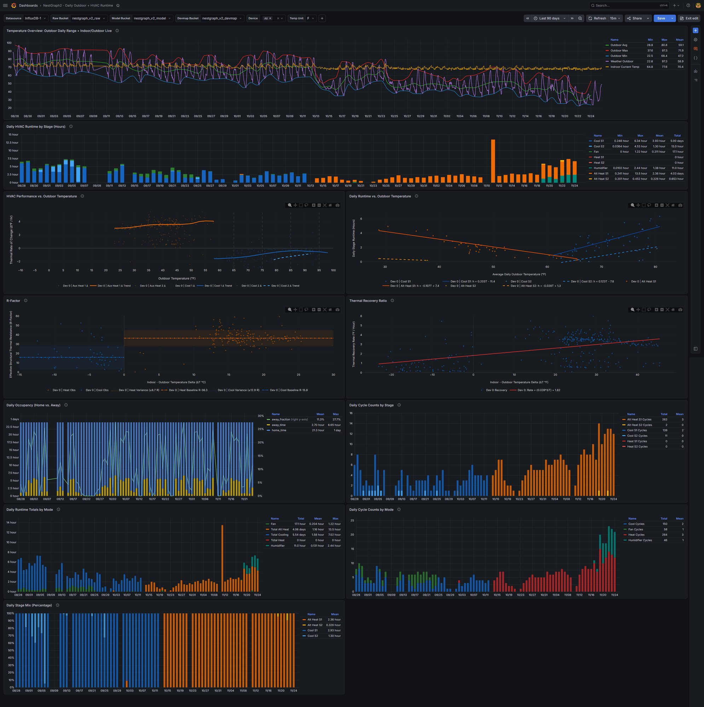
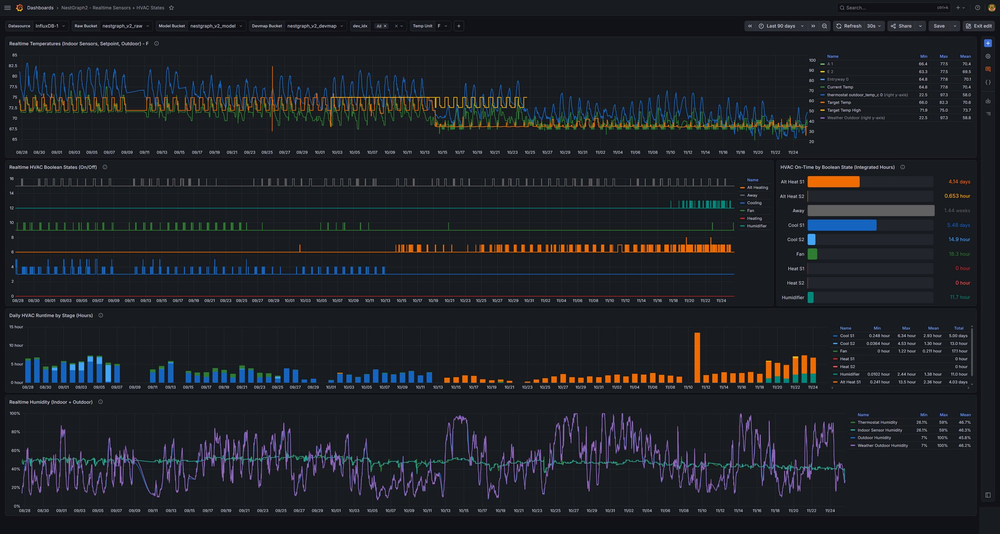

# nestgraph2

nestgraph2 is a Python collector that polls Nest thermostat and remote temperature sensor state via Google Home's Foyer protobuf API (`google.internal.home.foyer.v1` from [home.google.com](https://home.google.com)), decodes compiled protobuf payloads into structured device metrics, and writes time-series data to InfluxDB v2. Importable Grafana dashboards are included to visualize realtime and historical metrics.

It is designed to run as a long-lived daemon (Docker or local Python) with change-gated InfluxDB writes, compiled Foyer protobuf parsing, automated `accounts.google.com/RotateCookies` session keep-alive, and lightweight scheduled jobs for daily thermal metrics used by Grafana dashboards. Legacy Nest Observe gRPC-Web streaming is disabled by default (`connect_nest.data_source = "foyer"`) and can still be opted into via config if needed.

Sadly [Google's Smart Device Management (SDM) API](https://developers.google.com/nest/device-access/api/thermostat) didn't have all the staging information I was after. Instead, this project reverse engineered the necessary protobufs (originally Nest Observe for `home.nest.com`, and now Google Home Foyer `google.internal.home.foyer.v1` ahead of the `home.nest.com` shutdown) to collect full staging, humidifier, fan, and sensor telemetry. Likely some AI slop is still lingering here as I haven't gotten around to cleaning up all the cruft from my first vibe project. The interfaces could be extended to control the system, but because of the binary packed nature of the protobufs I didn't want any issues with unexpected commands so this project is data collection only.

## Dashboard Preview

### Metrics Dashboard



### Realtime Dashboard



## Getting Started

Use this sequence for a clean first-time setup.

Quick links:

- [1) Prerequisites](#gs-1-prerequisites)
- [2) Create Runtime Config](#gs-2-create-runtime-config)
- [3) Capture Google Home Auth And Create config/tokens.json](#gs-3-capture-nest-auth)
- [4) Docker Only Create .env](#gs-4-docker-env)
- [5) Start The Collector](#gs-5-start-collector)
- [6) Validate First Run](#gs-6-validate-first-run)
- [7) Import Dashboards Into Grafana](#gs-7-import-dashboards)

<a id="gs-1-prerequisites"></a>
### 1) Prerequisites

- Git clone of this repository.
- Python 3.12+ (for local runs), or Docker Desktop with Compose (for container runs).
- InfluxDB 2.x instance and API token with write access to your target bucket root.
- Google Home / Nest account access so you can capture a fresh [home.google.com](https://home.google.com) HAR and extract tokens.

<a id="gs-2-create-runtime-config"></a>
### 2) Create Runtime Config

Copy the example file and create your local runtime config:

```powershell
Copy-Item config\config.json.example config\config.json
```

Minimum required keys in `config/config.json`:

- `influxdb.url`
- `influxdb.token`
- `influxdb.org`
- `influxdb.bucket`

Commonly required weather keys:

- `weather.lat`
- `weather.lon`

Important: `config/config.json` is gitignored.

<a id="gs-3-capture-nest-auth"></a>
### 3) Capture Google Home Auth And Create `config/tokens.json`

The collector startup path is token/session based. Capture a HAR from Firefox while signed into https://home.google.com (do **not** sign out or close a private browsing window afterwards, or Google will invalidate the session), then extract tokens.

1. Sign in at https://home.google.com in a dedicated Firefox profile/container (or Private Window).
2. Open DevTools (`F12`) and go to Network.
3. Enable persistent logging and reload the page.
4. Wait until the Google Home API calls finish (`googlehomefoyer-pa.clients6.google.com` `GetHomeGraph` / `GetTraits` and `accounts.google.com/RotateCookies`).
5. Export HAR ("Save All As HAR") to this repo.
6. **Close the [home.google.com](https://home.google.com) tab immediately (do NOT click Sign Out)** so Firefox does not continue calling `RotateCookies` every 10 minutes and racing with the collector on `__Secure-*PSIDTS` cookie rotation.
7. Run (optionally add `--verify` to live-test the extracted credentials):

```powershell
python utilities/ff_har_tokens.py --har "home.google.com_Archive.har" --verify
```

This writes/merges `config/tokens.json` in `home_google` mode (auto-loading `NEST_TOKEN_ENCRYPTION_KEY` from `.env` if present; legacy `home.nest.com` HAR files are also still supported). By default (`connect_nest.data_source = "foyer"`), the collector runs in **Foyer-only mode** with all legacy Nest Observe / `home.nest.com` auth flows disabled:

- Keeps Google session cookies alive via `accounts.google.com/RotateCookies` (~540s cadence).
- Polls compiled Foyer protobuf RPCs (`EnergyService/GetThermostatStatus` every 30s for near-real-time HVAC stages, fan, humidifier, and thermostat temperatures; `HomeOccupancyService/GetStructureMode` every 120s; `HomeControlService/GetTraits` every 300s for remote sensors to stay well below Google's ~500-call quota; `StructuresService/GetHomeGraph` cached 30m).
- Legacy Nest Observe streaming can be re-enabled by setting `connect_nest.data_source` to `"auto"` (Observe with automatic Foyer fallback) or `"observe"` (and tested via `--verify-observe`).

Optional: if you use encrypted token storage, pass the same key used at runtime.
If you skip this, tokens are still encrypted on first collector run when a key is present:

```powershell
python utilities/ff_har_tokens.py --har "path\to\capture.har" --key "your-passphrase"
```

<a id="gs-4-docker-env"></a>
### 4) (Docker Only) Create `.env`

If you plan to run with Docker Compose, copy `.env.example` to `.env` and set values as needed.

Recommended key:

- `NEST_TOKEN_ENCRYPTION_KEY`

Optional overrides:

- `LIFECHECK_FILE`
- `LIFECHECK_INTERVAL_SECONDS`

When running in Docker Compose, the collector reads the key from `/run/secrets/nest_key` first,
then falls back to `NEST_TOKEN_ENCRYPTION_KEY` if no secret file is present.

<a id="gs-5-start-collector"></a>
### 5) Start The Collector

Choose one path.

Docker path (recommended for long-running deployment):

```powershell
.\start-collector.ps1
docker compose logs -f collector
```

Common startup options:

```powershell
# Build before start
.\start-collector.ps1 -Build

# Force recreate container on start
.\start-collector.ps1 -ForceRecreate

# Build and force recreate
.\start-collector.ps1 -Build -ForceRecreate

# Force config overwrite from local source folder
.\start-collector.ps1 -ForceConfigSync

# Show script usage/help
.\start-collector.ps1 -h
```

Local Python path (development):

```powershell
python -m venv .venv
.venv\Scripts\Activate.ps1
pip install -r requirements.txt
python -m src.main
```

Verbose decoded Observe snapshots:

```powershell
python -m src.main --verbose-observe-decoded
```

<a id="gs-6-validate-first-run"></a>
### 6) Validate First Run

After startup, confirm these checks:

- Collector logs show `Foyer-only mode active` and `Collector loop starting (data_source=foyer, ...)` with no repeated auth failures.
- `device_index` points are being written to `<bucket>_v2_devmap`.
- Thermostat, indoor sensor, and weather points are being written to `<bucket>_v2_raw`.

If you run with Docker, stop with:

```powershell
docker compose down
```

<a id="gs-7-import-dashboards"></a>
### 7) Import Dashboards Into Grafana

Copy the dashboard JSON files from this repo to the machine where you access Grafana:

- `grafana/metrics.json`
- `grafana/realtime.json`

Then import both dashboards in Grafana UI:

1. Open Grafana and go to `Dashboards` -> `New` -> `Import`.
2. Choose `Upload dashboard JSON file`.
3. Import `metrics.json`, then import `realtime.json`.
4. Select your InfluxDB data source when prompted.

Validation commands are in the Grafana Dashboards section below.

## What It Does

- Polls Google Home Foyer (`google.internal.home.foyer.v1`) via compiled protobuf bindings (or optionally streams legacy Nest Observe) and writes thermostat/sensor state on change.
- Keeps Google session cookies fresh automatically via `accounts.google.com/RotateCookies` with encrypted token persistence.
- Polls outdoor weather (Open-Meteo by default, Nest weather optional).
- Tracks state-duration events (heating/cooling/fan/humidifier/away and stage flags).
- Computes daily metrics and thermal resistance values.
- Maintains stable device index mapping (`device_id -> dev_idx`) in InfluxDB and local cache.

## Runtime Model

- Main entrypoint: `python -m src.main`
- Collector thread: `src.collector_event.EventThermostatCollector` (defaults to `data_source = "foyer"` polling; supports `"auto"` and `"observe"`)
- Scheduler: daily metrics compute at 02:00 in configured timezone (`settings.timezone`)
- Session keep-alive: background loop runs `RotateCookies` every `cookie_rotate_interval_sec` (default `540s`), plus Observe JWT refresh only when Observe is enabled
- Health heartbeat: lifecheck file touched only when Foyer poll / stream activity is fresh

## InfluxDB Buckets And Measurements

Bucket names are derived from `influxdb.bucket` in `config/config.json`:

- `<root>_v2_raw`
- `<root>_v2_model`
- `<root>_v2_rollup`
- `<root>_v2_event`
- `<root>_v2_devmap`

Primary measurements currently written by code:

- Raw bucket (`<root>_v2_raw`)
   - `thermostat`
   - `indoor_sensor`
   - `indoor_dynamics`
   - `weather`
   - `hvac_cycle`
   - `energy_daily`
   - `thermal_resistance`
- Model bucket (`<root>_v2_model`)
   - `computed_metrics`
- Event bucket (`<root>_v2_event`)
   - `state_duration_event`
- Devmap bucket (`<root>_v2_devmap`)
   - `device_index`

## Authentication

Collector startup is token/session based and reads auth values from config plus token cache.

Primary flow:

- Follow Step 3 in Getting Started to create or refresh `config/tokens.json` from a HAR capture.

Token cache file path is controlled by `connect_nest.token_file` (default `config/tokens.json`).

Extracted fields (when present) include:

- `auth_mode` (`home_google` or `legacy_nest`)
- `foyer_cookie_header` / `google_cookie_header`
- `foyer_api_key`, `foyer_authuser`, `foyer_client_environment`, `foyer_user_agent`
- `rotate_cookies_body` / `rotate_cookies_referer`
- `userid` / `user` / `nest_user_id`
- Legacy Observe fields (when present): `issue_token`, `google_bearer_token`, `access_token`, `transport_url`

Note: runtime token cache uses `userid` in `tokens.json`. The config override key is `nest.user_id`.

Custom output path:

```powershell
python utilities/ff_har_tokens.py --har "path\\to\\capture.har" --out config/tokens.json
```

If token file encryption is enabled, pass the same key used by the collector (or set `NEST_TOKEN_ENCRYPTION_KEY`):

```powershell
python utilities/ff_har_tokens.py --har "path\\to\\capture.har" --key "your-passphrase"
```

To decrypt an encrypted tokens file back to plaintext JSON:

```powershell
python utilities/ff_har_tokens.py --decrypt --out config/tokens.json --key "your-passphrase"
```

## Config Keys (Current)

Top-level sections expected by code:

- `nest`
   - `postal_code`, `country_code`
- `influxdb`
   - `url`, `token`, `org`, `bucket`
- `weather`
   - `lat`, `lon`, `outdoor_source` (`open_meteo` or `nest`)
- `connect_nest`
   - `data_source` (`"foyer"` default, `"auto"`, or `"observe"`)
   - `foyer_poll_interval_sec` (default `30` — `GetThermostatStatus` cadence)
   - `foyer_traits_poll_interval_sec` (default `300` — `GetTraits` cadence for remote sensors)
   - `foyer_structure_mode_poll_interval_sec` (default `120` — `GetStructureMode` cadence)
   - `cookie_rotate_interval_sec` (default `540` — `RotateCookies` keep-alive cadence)
   - `observe_timeout_sec`, `token_refresh_margin_sec`, `token_file`
- `settings`
   - `timezone`, `temp_units`, `analog_min_interval_seconds`,
      `weather_poll_interval_seconds`, `mapping_sync_interval_seconds`,
      `device_label_short_id_len`, `log_level`

Additional note on defaults:

- `analog_min_interval_seconds` defaults to `60` if omitted.
- `weather_poll_interval_seconds` defaults to `900` if omitted.
- The provided `config/config.json.example` is intentionally minimal; optional runtime keys above can be added as needed.

### Debug / Advanced Overrides

These keys are supported by code but are typically used for troubleshooting, migrations, or specialized setups.

- `nest` auth override keys:
   - `access_token`, `transport_url`, `user_id`, `user`, `google_bearer_token`

## Metrics Backfill And Recompute

Dry run:

```bash
python -m src.metrics --cadence-hours 24 --backfill-days 14 --loop-interval-hours 24 --dry-run
```

Write mode:

```bash
python -m src.metrics --cadence-hours 24 --backfill-days 14 --loop-interval-hours 24
```

Optional fallback mode (if `state_duration_event` data is missing):

```bash
python -m src.metrics --cadence-hours 24 --backfill-days 14 --loop-interval-hours 24 --enable-duration-fallback
```

Targeted date range helper script:

```bash
python utilities/backfill_metrics.py --start 2026-01-01 --end 2026-01-31
```

Delete prior backfill measurements before recompute:

```bash
python utilities/delete_backfill_measurements.py
```

## Grafana Dashboards

Dashboards live in `grafana/`:

- `grafana/metrics.json`
- `grafana/realtime.json`

### Dashboard Validation

Validation script:

- `scripts/validate-grafana-dashboard.ps1`

Examples:

```powershell
powershell -NoProfile -ExecutionPolicy Bypass -File scripts/validate-grafana-dashboard.ps1
powershell -NoProfile -ExecutionPolicy Bypass -File scripts/validate-grafana-dashboard.ps1 -DashboardPath grafana/realtime.json
```

See `grafana/README.md` for task-based validation details.

## Protobuf Workflow

Both legacy Nest Observe `.proto` definitions and Google Home Foyer v1 `.proto` definitions (`nest-observe/protobuf/pb/foyer/*.proto`) live in the `nest-observe` submodule and compile into `proto/generated/` (including `proto/generated/foyer/*_pb2.py`).

Compile protobuf bindings:

- Windows: `scripts\compile_protos.bat`
- Cross-platform Python: `python scripts/compile_protos.py`
- Linux/macOS/WSL: `bash scripts/compile_protos.sh`

Inspecting updated Google Home Android APK Protobuf-Lite descriptors (optional):

```powershell
python tests/extract_apk_foyer_protos.py "path\to\google_home.apkm" --rpc GetThermostatStatus GetStructureMode --enums
```

Additional details:

- `docs/protobuf_compilation.md`
- `docs/proto_capture.md`

## Project Layout

```text
nestgraph2/
|-- config/
|   |-- config.json.example
|-- docs/
|   |-- protobuf_compilation.md
|   |-- proto_capture.md
|-- grafana/
|   |-- README.md
|   |-- dash_snip_helper.py
|   |-- metrics.json
|   |-- realtime.json
|   `-- schema/
|-- nest-observe/            # git submodule (Observe + protobuf/pb/foyer/*.proto)
|-- proto/
|   |-- generated/
|       `-- foyer/           # compiled Google Home Foyer v1 *_pb2.py bindings
|-- scripts/
|   |-- compile_protos.bat
|   |-- compile_protos.py
|   |-- compile_protos.sh
|   `-- validate-grafana-dashboard.ps1
|-- src/
|   |-- main.py
|   |-- collector.py
|   |-- collector_event.py
|   |-- foyer_client.py
|   |-- grpc_web.py
|   |-- nest_client.py
|   |-- metrics.py
|   |-- influx_writer.py
|   |-- weather_client.py
|   `-- token_store.py
|-- tests/
|   |-- extract_apk_foyer_protos.py
|   |-- test_decoders.py
|   `-- test_foyer_and_har.py
|-- utilities/
|   `-- ff_har_tokens.py
|-- docker-compose.yml
|-- Dockerfile
`-- requirements.txt
```

## Troubleshooting

- Config not found:
   - Set `CONFIG_PATH` or create `config/config.json` from example.
- Foyer auth fails (`HTTP 401 SESSION_COOKIE_INVALID`):
   - Make sure the [home.google.com](https://home.google.com) browser tab used for HAR capture was closed immediately (without clicking Sign Out) so the browser does not race `RotateCookies` against the collector; recapture a fresh HAR and re-run `utilities/ff_har_tokens.py --verify`.
- Foyer `GetTraits` rate limit (`HTTP 429 RESOURCE_EXHAUSTED`):
   - `GetTraits` is throttled to `300s` by default and backs off automatically without interrupting `GetThermostatStatus`. Increase `connect_nest.foyer_traits_poll_interval_sec` if you have many devices.
- No devices discovered in metrics run:
   - Ensure `device_index` has been populated by running collector first.
- Container unhealthy:
   - Check Foyer polling / RotateCookies logs and lifecheck freshness.
- Weather fields are null:
   - Verify `weather.lat/lon` for Open-Meteo, or `nest.postal_code` for Nest weather mode.
